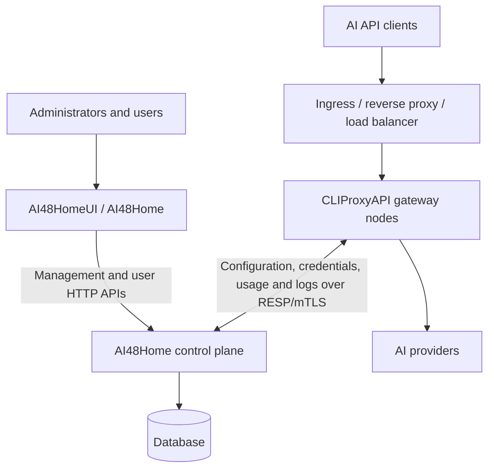

# AI48HomeUI

AI48HomeUI, branded as **AI48Home**, is the browser-based administration panel and user portal for [AI48Home](https://github.com/sofyan48/AI48Home). It provides a Web interface for operating clusters of AI gateways powered by [CLIProxyAPI](https://github.com/router-for-me/CLIProxyAPI).

This project builds on [Home Management Center](https://github.com/router-for-me/Home-Management-Center). See [Credits](#credits) and [License](#license) for attribution and licensing.

## Relationship with AI48Home

The three projects have distinct responsibilities:

| Project | Responsibility |
| --- | --- |
| [AI48HomeUI](https://github.com/sofyan48/AI48HomeUI) | Presentation layer: administrator controls, user account flows, and visibility into configuration, usage, and gateway operations. |
| [AI48Home](https://github.com/sofyan48/AI48Home) | Database-backed control plane: configuration, credentials, scheduling, node coordination, usage aggregation, and APIs consumed by this UI. |
| [CLIProxyAPI](https://github.com/router-for-me/CLIProxyAPI) | AI gateway nodes: process AI API requests, obtain configuration and dispatchable credentials from Home, and report usage and request logs. |



**AI48HomeUI is not a standalone AI gateway or backend.** It needs a running AI48Home instance for authentication, data storage, management actions, and user services. The UI does not schedule credentials or route AI inference traffic itself. Home coordinates the gateways; an ingress, reverse proxy, or load balancer distributes incoming AI requests across gateway nodes or clusters.

The repositories are maintained separately, but **AI48Home releases and Docker images embed AI48HomeUI** so the backend and panel can be deployed together. A separate UI deployment is optional, not required for the bundled installation.

## Workspaces

- **Administrator workspace** (`/admin`): management of the Home deployment, providers and credentials, routing, users, billing, configuration, diagnostics, logs, and usage. Connect at `/admin/connect` using a management key.
- **User workspace** (`/app`): account login and registration, model catalog, API keys, balance, profile, and settings. Sign in at `/app/login`.

Available features depend on the connected Home version, enabled capabilities, and account permissions. UI visibility checks do not replace backend authorization.

## Technology

- Nuxt 4, Vue 3, and TypeScript, running as a client-side SPA (`ssr: false`).
- Pinia for session, capability, configuration-cache, and workspace state.
- Tailwind CSS 4, source-owned shadcn-vue/Reka UI components, Tabler icons, and Sonner notifications.
- Bun for dependency installation, scripts, and tests; `bun.lock` is the dependency lockfile.

## Local development

Install [Bun](https://bun.sh/) and start AI48Home separately. From this repository root:

```bash
bun install
NUXT_PUBLIC_API_URL=http://127.0.0.1:8327 bun run dev
```

Open:

- `http://localhost:3000/admin/connect` for administrator access.
- `http://localhost:3000/app/login` for user access.

### Backend connection and security

`NUXT_PUBLIC_API_URL` is the **backend address reached by the browser**, not an internal container-only hostname. Prefer an origin-only value such as `http://127.0.0.1:8327`. A URL ending in `/v8/management` is normalized to its origin.

- Administrator requests use the `/v8/management` API.
- User requests use the `/user` API.
- An empty API URL uses same-origin requests, as required for the embedded deployment.
- If the UI and Home use different origins, Home must allow requests from the UI origin.
- Enter the management key at `/admin/connect`. Home must have its Management API enabled through `remote-management.secret-key`.
- Never put management secrets in `NUXT_PUBLIC_*` variables or public runtime configuration: these values are visible to the browser.
- Admin and user sessions are separate. Use HTTPS for production access.

For static generation, set `NUXT_PUBLIC_API_URL` when generating the bundle; changing a static host's environment afterward does not rewrite already-generated browser assets.

## Development commands

| Command | Purpose |
| --- | --- |
| `bun install` | Install dependencies and prepare Nuxt. |
| `bun run dev` | Start the local development server, normally on port 3000. |
| `bun run test` | Run unit, translation-key, SFC compilation, and structural checks. |
| `bun run build` | Build the application for production. |
| `bun run preview` | Preview a production build locally. |
| `bun run generate` | Generate a static SPA into `.output/public`. |
| `bun run build:embedded` | Generate and package the same-origin SPA into `dist/` for Home. |

Use `bun run test` for routine verification. A build does not substitute for TypeScript checking or browser interaction tests. See [CONTRIBUTING.md](CONTRIBUTING.md) for code organization and contribution guidance.

## Deployment

### Bundled with AI48Home (recommended)

Install an [AI48Home release or Docker image](https://github.com/sofyan48/AI48Home#install-from-ghcr). The Web interface is included; no separate Node.js or Bun frontend server is needed at runtime.

```bash
docker pull ghcr.io/sofyan48/ai48home:latest
```

Follow the backend README for database, management key, networking, and container configuration. Open `/admin/connect` or `/app/login` on the Home address, for example `http://localhost:8327/admin/connect`. Update the Home binary or image to update the bundled panel.

### Separate static UI

To host the frontend independently of Home:

```bash
NUXT_PUBLIC_API_URL=https://home.example.com bun run generate
```

Serve `.output/public` through a static Web server configured with SPA fallback to `index.html`, including deep links under `/admin/*` and `/app/*`. Configure Home to allow the UI origin. The backend remains a separate, required service.

### Build a local embedded bundle

Generate the bundle expected by Home's `internal/managementasset` package:

```bash
bun run build:embedded
```

This command clears `NUXT_PUBLIC_API_URL` for same-origin access and writes `dist/index.html`, `dist/management.html`, `dist/user.html`, and hashed files under `dist/assets/`. These HTML filenames are internal build artifacts, not the recommended browser entry points.

With both repositories next to each other, build and copy the panel into Home:

```bash
make -C ../AI48Home panel-assets-local PANEL_SOURCE_DIR=../AI48HomeUI
```

The next Home build embeds the files through Go's `embed` package. Home serves the admin SPA at `/admin` and `/admin/*`, and the user SPA at `/app` and `/app/*`.

Do not hand-edit generated files in `dist/`, `.nuxt/`, or `.output/`; change the source or packaging script instead.

## Release integration

Pull requests and pushes to `main` run `.github/workflows/ci.yml`: dependency installation, request-telemetry tests, and `bun run build:embedded`, followed by bundle entry-point verification.

After a successful push to `main`, the workflow sends a `panel-updated` dispatch to [AI48Home](https://github.com/sofyan48/AI48Home) to request a fresh bundled `ghcr.io/sofyan48/ai48home:edge` image. AI48Home release tags (`v*`) publish versioned and `:latest` images.

The dispatch requires this repository secret:

| Secret | Value |
| --- | --- |
| `HOME_DISPATCH_TOKEN` | Fine-grained PAT for `sofyan48/AI48Home` with **Contents: Read and write** (classic PAT: `repo`). |

Without the secret, CI still builds and tests the panel but skips the Home image trigger. Use `:edge` for the newest integrated panel, or `:latest` for the published release.

## State management

Application state is managed by Pinia:

- `stores/userSession.ts`: user session, capabilities, account, and authentication actions.
- `stores/managementSession.ts`: management token and remember preference.
- `stores/managementCapabilities.ts`: management capabilities and server metadata.
- `stores/managementConfig.ts`: short-lived configuration cache and request deduplication.
- `stores/workspace.ts`: namespaced admin/user data and request status.

Pages use `useWorkspaceState` for writable store-backed refs and `useStoreData` for asynchronous data loading. Workspace owners initialize fresh state on mount, and obsolete owners cannot overwrite replacement state. Token changes clear the corresponding workspace domain. Workspace data is not persisted.

Transient forms, modal visibility, filters, and pagination remain component-local. Request timers and lifecycle cleanup remain with their components.

## Credits

- [Home Management Center](https://github.com/router-for-me/Home-Management-Center): upstream foundation for this panel, licensed under MIT.
- [CLIProxyAPIHome](https://github.com/router-for-me/CLIProxyAPIHome): upstream foundation for the AI48Home control plane.
- [CLIProxyAPI](https://github.com/router-for-me/CLIProxyAPI): the AI gateway project managed through Home.
- The Nuxt, Vue, Pinia, Tailwind CSS, shadcn-vue, Reka UI, Tabler, and Sonner communities for the frontend tools used here.

## License

AI48HomeUI is distributed under the [MIT License](LICENSE). The license preserves the upstream Home Management Center copyright notice and includes attribution for AI48HomeUI contributions.

MIT permits use, modification, redistribution, and commercial use, provided the copyright and permission notices are retained in copies or substantial portions of the software. The software is provided **without warranty**; see the full license for its terms.

Third-party dependencies and assets remain subject to their respective licenses. AI48Home and CLIProxyAPI are separate projects; consult their repositories for their applicable license terms.
